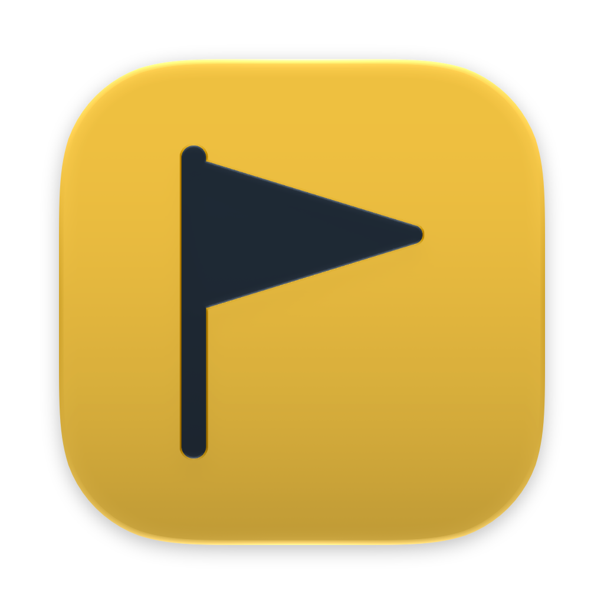
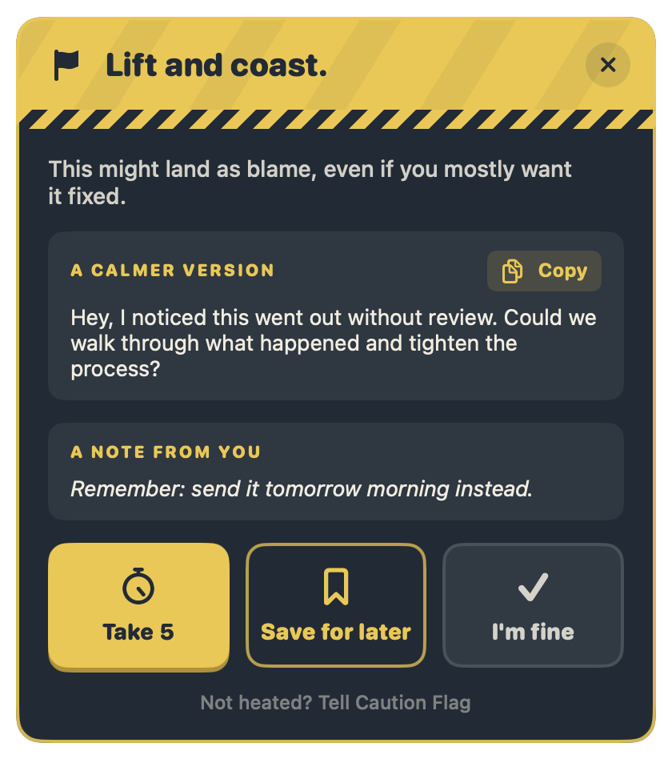

<p align="center"></p>

<h1 align="center">Caution Flag</h1>

<p align="center">A macOS menu bar app that notices when a chat draft is running hot<br>and raises a flag before you send it. Tone checks run entirely on your Mac.</p>

<p align="center"></p>

## Install

```sh
brew install --cask taylorbird/caution-flag/caution-flag
```

Requires macOS 15 or later. Apple's on-device model needs macOS 26 or later with Apple Intelligence on; otherwise Caution Flag can use a local [Ollama](https://ollama.com) server.

On first launch, a short setup guide asks for **Accessibility** access (System Settings › Privacy & Security › Accessibility), which lets Caution Flag read the message box in apps you choose.

## What it does

- Watches the message box in Slack and any other apps you switch on, and rates the tone of your draft as you type.
- **Warm:** the menu bar flag turns yellow and a small pill appears above the message box. It fades on its own.
- **Hot:** the flag turns red, the screen dims around your message, and a caution-tape panel explains why. It offers a calmer rewrite you can copy, shows a note you wrote to yourself, and gives you three choices: **Take 5** (a breathing timer), **Save for later**, or **I'm fine**.
- **Quick runs:** several short messages sent back to back are read together with the next draft.
- **Not heated:** if it misreads a message, one click saves it on your Mac for tuning.

## Privacy

- Draft text stays in memory. It is never logged and never sent anywhere.
- Tone checks run on your Mac: Apple's on-device model, or Ollama at a local address only.
- Text reaches disk only when you click **Save for later** or **Not heated**, and both files stay on your Mac.

## Updates

Caution Flag updates itself: it checks once a day and installs signed updates the next time it relaunches. You can also choose **Check for Updates…** from the menu bar flag. Homebrew knows this (`auto_updates true`), so `brew upgrade` leaves it alone unless you pass `--greedy`.

## About this repo

This is the Homebrew tap and update feed. Release zips are signed with Developer ID, notarized by Apple, and attached to this repo's GitHub releases. `appcast.xml` is the Sparkle feed the app checks. The source lives at [taylorbird/caution-flag](https://github.com/taylorbird/caution-flag).
